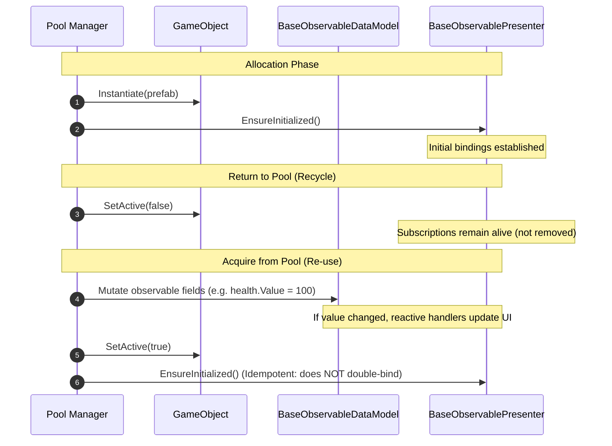

# Handling Runtime Objects, Prefabs & Pooling in MMVC

This guide covers best practices and architectural patterns for creating, configuring, and reusing MMVC units at runtime in Unity, including dynamically instantiated prefabs, inactive objects, object pooling, and programmatic GameObject composition.

---

## Quick Summary

- **Prefabs saved inactive (Recommended):** Instantiate while inactive, configure properties and identity, then call `SetActive(true)`. Calling `logic.GetModel()` while inactive ensures the presenter is initialized early.
- **Prefabs saved active:** `Instantiate` executes `Awake()` and `OnEnable()` immediately; `SetActive(false)` called *after* `Instantiate` cannot defer or undo `Awake()`.
- **Callback Ordering Across Dynamic Instances:** Unity script execution orders prioritize callbacks between script types, but do **not** enforce global sequence guarantees across separately created runtime instances.
- **Object Pooling:** Bindings can stay alive across pool cycles; if you unbind on release with `Observable.RemoveListeners`, `EnsureInitialized()` rebinds on checkout.
- **Code-Created Objects (`AddComponent`):** Build inactive, add all required components explicitly, configure fields, and call `presenter.EnsureInitialized()` before activating.

---

## 1. Instantiation Patterns: Inactive vs Active Prefabs

```mermaid
flowchart TD
    subgraph InactiveFlow ["1. Inactive Prefab Instantiation (Recommended)"]
        I_Inst["Object.Instantiate(inactivePrefab)<br/>(Prefab asset has activeSelf == false)"]
        I_Wait["Awake() and OnEnable() do NOT run yet"]
        I_Cfg["Configure Logic & Model fields directly<br/>e.g. logic.SetSingletonName('Minion_1')"]
        I_Early["logic.GetModel() triggers presenter.EnsureInitialized() safely"]
        I_Act["gameObject.SetActive(true)<br/>Presenter.Awake() runs: idempotent no-op (no double-binding)"]

        I_Inst --> I_Wait --> I_Cfg --> I_Early --> I_Act
    end

    subgraph ActiveFlow ["2. Active Prefab Instantiation"]
        A_Inst["Object.Instantiate(activePrefab)<br/>(Prefab asset has activeSelf == true)"]
        A_Awk["Unity immediately executes Awake() & OnEnable() on all components"]
        A_Init["Presenter.Awake() calls EnsureInitialized()<br/>Handlers & AutoBind are wired to default model values"]
        A_Later["Mutating model afterwards fires reactive events to UI"]

        A_Inst --> A_Awk --> A_Init --> A_Later
    end
```



### Pattern A: Inactive Prefabs (Configure First, Then Activate)
If a prefab is saved with its root GameObject inactive (`prefab.activeSelf == false`):
- Unity does **not** execute `Awake()`, `OnEnable()`, or `Start()` during `Instantiate`.
- You can configure singleton names, parameters, and model values without triggering premature callbacks.
- Calling `logic.GetModel()` while inactive triggers `presenter.EnsureInitialized()`, safely pre-binding the unit.
- Calling `gameObject.SetActive(true)` activates the GameObject. When Unity invokes `BaseObservablePresenter.Awake()`, it runs `EnsureInitialized()`, which recognizes that the presenter is already initialized and bound and exits immediately without duplicate bindings.

> **Crucial Unity Engine Rule:**  
> Calling `instance.SetActive(false)` *after* `Instantiate(activePrefab)` **cannot** defer `Awake()`! By the time `Instantiate()` returns, `Awake()` and `OnEnable()` have already finished executing on active prefabs. To defer `Awake()`, the source prefab asset itself must have `activeSelf == false`, or you must instantiate under an inactive parent (`activeInHierarchy == false`).

### Component Enable State vs GameObject Active State
- **Disabled component (`enabled = false`) on an active GameObject:** Unity still invokes `Awake()`! However, `OnEnable()` and `Start()` do not execute until `enabled = true`.
- **Component on an inactive GameObject (`activeInHierarchy == false`):** Unity executes **no** lifecycle methods (`Awake()`, `OnEnable()`, `Start()`) until the GameObject becomes active in hierarchy.
- **`OnDestroy` on inactive objects:** If an inactive unit is bound manually and destroyed without ever being activated, Unity may not invoke `OnDestroy()`. Call `Observable.CleanupSubscriptions(model)` explicitly before destroying such units.

---

## 2. Inactive Object Setup Example: Configure First Pattern

```csharp
using UnityEngine;
using SavableObservable;

public class Spawner : MonoBehaviour {
    [SerializeField] private GameObject characterPrefab; // Ensure characterPrefab.activeSelf is false!

    public void SpawnCharacter(string characterId, int startingHealth) {
        // Guard against active prefabs where Awake() would execute immediately
        if (characterPrefab.activeSelf) {
            Debug.LogWarning("[Spawner] characterPrefab is active! For reliable configure-first setup, save the prefab asset inactive.");
        }

        // 1. Instantiate the inactive prefab (Awake does not run yet)
        GameObject instance = Instantiate(characterPrefab, transform);

        var logic = instance.GetComponent<CharacterLogic>();
        
        // 2. Configure identity / dependencies prior to registration
        logic.SetSingletonName($"Character_{characterId}");

        // 3. Configure Model state
        // Calling GetModel() on BaseLogic ensures model and presenter are initialized early
        var model = logic.GetModel();
        model.health.Value = startingHealth;
        model.characterId.Value = characterId;

        // 4. Activate GameObject: Awake() runs, EnsureInitialized() is an idempotent no-op
        instance.SetActive(true);
    }
}
```

---

## 3. Object Pooling & Lifecycle Reuse



### Pooling Principles:
1. **Retain Subscriptions:**  
   MMVC binds in `EnsureInitialized()` and detaches in `OnDestroy()`. Deactivating an object (`SetActive(false)`) does not detach bindings.
2. **Re-activation Is Safe:**  
   Calling `presenter.EnsureInitialized()` on pool checkout is completely idempotent and will never duplicate event handlers.
3. **Optional Unbind/Rebind:**  
   Bindings can stay alive across pool cycles. If you unbind on release with `Observable.RemoveListeners(model, presenter)`, the presenter is marked unbound and `presenter.EnsureInitialized()` rebinds on checkout.
4. **Model Mutation:**  
   Update model values when checking out or checking in. When an observable's value changes, subscribers are notified immediately. If an observable is assigned an identical value, no notification is sent.

---

## 4. Code-Created Objects & AddComponent Limitations

### The Runtime AddComponent Limitation
In the Unity Editor, attaching `BaseLogic<M, P>` to a GameObject automatically attaches `M` and `P` via `ComponentAutoRequire`.  
**At runtime, this auto-provisioning is not present.** The helper method contains an explicit check (`Application.isPlaying`), and its internal delay logic is compiled only in editor builds (`#if UNITY_EDITOR`). Calling `gameObject.AddComponent<TLogic>()` at runtime in play mode will **not** automatically add `TModel` or `TPresenter`.

### Recommended Pattern: Programmatic Construction
When building an MMVC GameObject entirely in code:
1. Create the GameObject inactive (`SetActive(false)`).
2. Add all components (`Model`, `Presenter`, `Logic`, and UI elements).
3. Wire UI serialized/public references on the presenter.
4. Call `presenter.EnsureInitialized()` or `logic.GetModel()`.
5. Activate the GameObject (`SetActive(true)`).

```csharp
using UnityEngine;
using TMPro;
using SavableObservable;

// Illustrative application types
public class RuntimePlayerModel : BaseObservableDataModel {
    public ObservableVariable<int> health = new ObservableVariable<int>();
}

public class RuntimePlayerPresenter : BaseObservablePresenter<RuntimePlayerModel> {
    [AutoBind(nameof(RuntimePlayerModel.health))]
    public TextMeshProUGUI healthText;
}

public class RuntimePlayerLogic : BaseLogic<RuntimePlayerModel, RuntimePlayerPresenter> {
    protected override bool RegisterAsSharedSingleton => false;
}

public static class RuntimeUnitFactory {
    public static GameObject CreatePlayerUnit(Transform parent) {
        // 1. Build inactive so Awake/OnEnable don't fire during construction
        var go = new GameObject("PlayerUnit");
        go.transform.SetParent(parent, false);
        go.SetActive(false);

        // 2. Add UI and MMVC components explicitly
        var textObj = new GameObject("HealthText", typeof(RectTransform), typeof(TextMeshProUGUI));
        textObj.transform.SetParent(go.transform, false);
        var label = textObj.GetComponent<TextMeshProUGUI>();

        var model = go.AddComponent<RuntimePlayerModel>();
        model.EnsureFieldsInitialized();

        var presenter = go.AddComponent<RuntimePlayerPresenter>();
        presenter.healthText = label;

        var logic = go.AddComponent<RuntimePlayerLogic>();

        // 3. Initialize bindings while inactive
        presenter.EnsureInitialized();

        // 4. Activate GameObject
        go.SetActive(true);

        return go;
    }
}
```

> **Design Tip:** Prefer using prefabs over runtime `AddComponent`. Prefabs serialize and preserve UI references automatically in the Unity Inspector.

---

## 5. Non-Singleton Units & Opting Out of ServiceLocator

When creating multiple dynamic instances (e.g. 50 bullet chips or 20 monster units):
- By default, `BaseLogic` registers itself into `ServiceLocator`.
- Multiple instances with identical names will collide and be evicted from service resolution.
- For dynamic units that are not intended to be global singletons, override `RegisterAsSharedSingleton => false`:

```csharp
public class MonsterLogic : BaseLogic<MonsterModel, MonsterPresenter> {
    protected override bool RegisterAsSharedSingleton => false;
}
```

This prevents registration overhead, avoids eviction collisions, and keeps the unit fully reactive on its own GameObject.

---

## 6. Pitfalls with Runtime Objects

1. **Handlers Executing While Inactive:**  
   Mutating a model while its GameObject is inactive will invoke presenter handlers if the value actually changes. Ensure presenter handlers do not call methods that require an active object (such as `StartCoroutine`, which logs an error when invoked on an inactive GameObject).
2. **No Replay on Activation:**  
   Activating an object does not replay model values into the presenter. The presenter should set initial UI values during `InitializePresenter()`.
3. **Never-Active Inactive Destruction:**  
   If an inactive object is early-bound via `EnsureInitialized()` or `logic.GetModel()` and destroyed without ever being activated, call `Observable.CleanupSubscriptions(model)` before destroying to avoid dangling delegates.

---

## 7. Cross-References

- [Unity Lifecycle & Automatic SetListeners](UnityLifecycle.md): Execution-order pipeline, ServiceLocator discovery, and binding sequences.
- [Testing Guide & Universal Test Runner](Testing.md): Automated unattended testing guide.
- Test Coverage:
  - [`Tests/Editor/PrefabAndPoolingLifecycleTests.cs`](../Tests/Editor/PrefabAndPoolingLifecycleTests.cs)
  - [`Tests/Runtime/MmvcPrefabPlayModeTests.cs`](../Tests/Runtime/MmvcPrefabPlayModeTests.cs)
