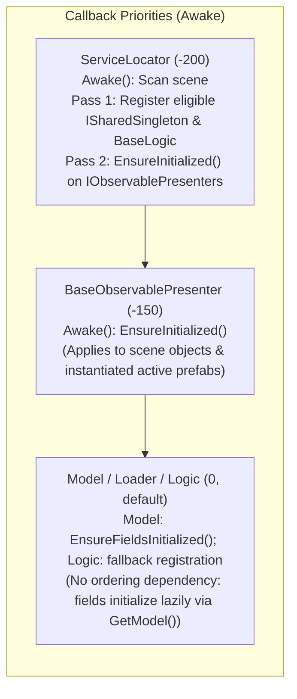
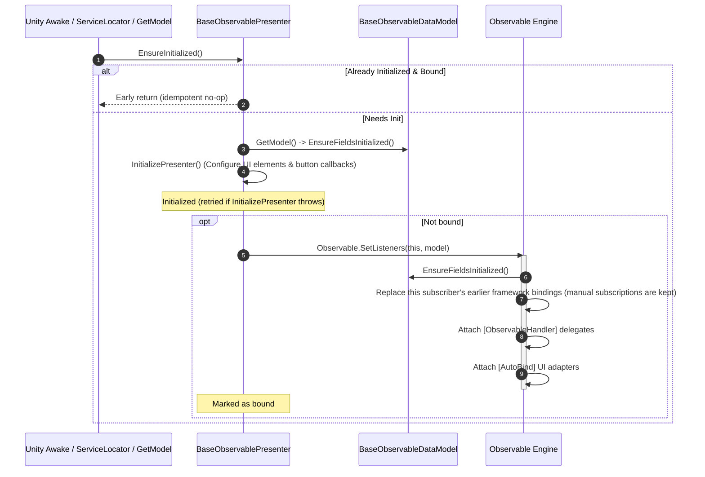
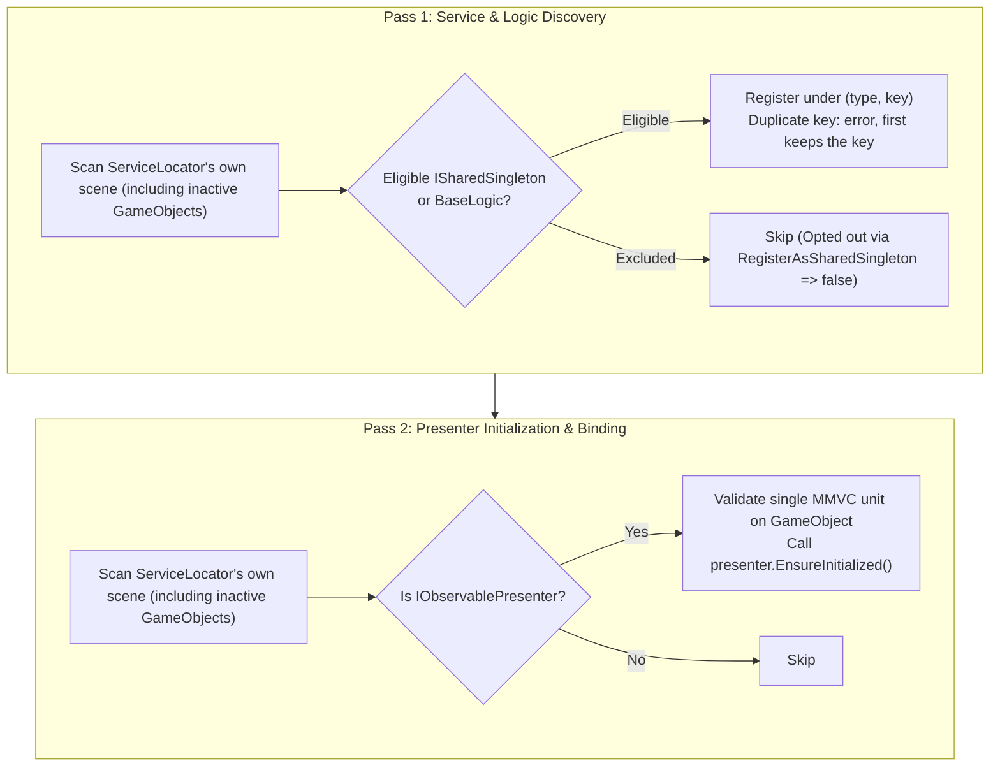
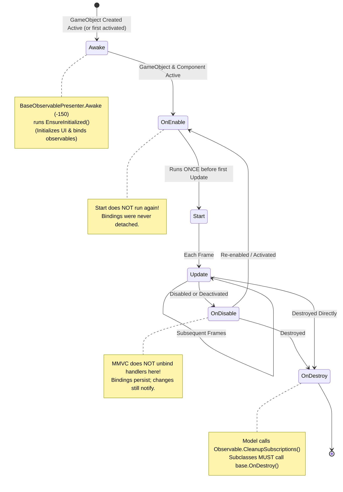
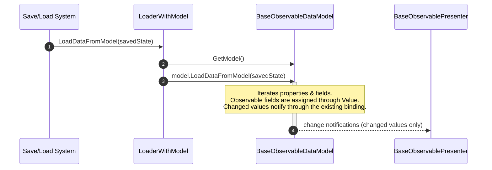

# Unity Lifecycle & Automatic SetListeners in MMVC

This document details the lifecycle hooks, script execution order, discovery passes, and reactive binding mechanics of the MMVC framework for Unity.

---

## Quick Answer: Do I Need to Call `SetListeners` Manually?

**No.** For ordinary usage, you do not need to call `Observable.SetListeners(...)` manually.

- **Scene Objects:** `ServiceLocator` scans the scene on startup and automatically initializes all presenters and wires their `[AutoBind]` and `[ObservableHandler]` listeners.
- **Prefabs & Spawned Units:** When a prefab or unit is activated or when `logic.GetModel()` is called, `BaseObservablePresenter.Awake()` or `BaseLogic.GetModel()` automatically runs `EnsureInitialized()`, which wires all listeners idempotently.
- **When is manual calling used?** Only in specialized framework code or custom low-level test harnesses. Loaders do not call it: loading data into the model reaches the presenter through its existing binding.

---

## 1. Script Execution Order

Only two framework types depend on execution order. `MMVCExecutionOrderSynchronizer` (`Editor/MMVCExecutionOrderSynchronizer.cs`) applies the orders across runtime scripts under `Assets/` (the types also declare them with `[DefaultExecutionOrder]`):

| Order | Class | Primary Role | Lifecycle & Operational Details |
|---|---|---|---|
| **`-200`** | `ServiceLocator` | Scene Discovery | `Awake()` scans **its own scene**. Carries explicit `[DefaultExecutionOrder(-200)]` attribute in code and synchronized to `.meta` via `MMVCExecutionOrderSynchronizer`. **Pass 1:** Registers eligible `ISharedSingleton` services (a Logic's model is resolved through its registered Logic). **Pass 2:** Calls `EnsureInitialized()` on all scene `IObservablePresenter` components (active and inactive). |
| **`-150`** | `BaseObservablePresenter<M>` | Presentation Layer | `Awake()` calls `EnsureInitialized()`, which executes `InitializePresenter()` once and then binds `Observable.SetListeners()`. Subclasses overriding `Awake()` or `OnDestroy()` **must** call base methods, or prefer `InitializePresenter()`. |
| **`0`** (default) | `BaseObservableDataModel`, `LoaderWithModel<M>`, `BaseLogic<M, P>` | Data, Persistence, Business Logic | No ordering requirement. The model's `Awake()` calls `EnsureFieldsInitialized()`, and every reader (presenter, logic, loader, `ServiceLocator`) also initializes the fields lazily through `GetModel()`, so it does not matter whether the model's `Awake()` has run. `LoaderWithModel<M>` has no `Awake()` or `Start()` of its own and never loads automatically. `BaseLogic<M, P>` has no `Start()` in the base class; its `Awake()` registers it as an `ISharedSingleton` if not already discovered by `ServiceLocator`. Subclasses overriding `Awake()` or `OnDestroy()` **must** call base methods. |

> **Important Architecture Note:**  
> These orders provide priority ordering for Unity callbacks (e.g. `Awake`) between types, **not** a universal single-timeline guarantee across all arbitrary objects in a project, nor across dynamically instantiated runtime instances. The synchronizer resets models, loaders and logic to `0` unless the class declares its own `[DefaultExecutionOrder]`, clearing earlier non-default orders written by older versions.



---

## 2. Presenter Initialization & SetListeners Sequence

A `BaseObservablePresenter<M>` initializes once and binds its listeners once; repeating the call never duplicates handlers.

### Guarantees
1. **`EnsureInitialized()`** is the single entry point (Unity `Awake`, `ServiceLocator`, `Logic.GetModel()`, pooling checkout):
   - Idempotent: once initialized and bound, it returns immediately.
   - Initializes the model fields, runs `InitializePresenter()` once, then attaches the listeners.
   - Nested calls made while `InitializePresenter()` is running (for example through `logic.GetModel()`) return without binding; the outer call binds after `InitializePresenter()` completes.
   - If `InitializePresenter()` throws, the presenter is not marked initialized: the next call retries.
   - `Observable.RemoveListeners(model, presenter)` marks the presenter as unbound, so the next `EnsureInitialized()` rebinds. An explicit `Observable.SetListeners(presenter, model)` also runs `InitializePresenter()` first when it has not run yet, and marks the presenter as bound.
2. **`InitializePresenter()`**:
   - Subclass hook for configuring UI controls (wiring button clicks, setting dropdown choices, configuring canvas groups). Prefer this hook over overriding `Awake()`.
   - **Ordering guarantees:**
     - `InitializePresenter()` always completes **before** `Observable.SetListeners()` attaches handlers, including when it calls `GetLogic().GetModel()`.
     - For scene-resident objects initialized during `ServiceLocator` Pass 2, `InitializePresenter()` runs **after** Pass 1 service registration. Note, however, that service availability inside `InitializePresenter()` depends strictly on those services being present in the scanned scene, eligible, and unique (a duplicate key is an error and the second instance is not registered).



---

## 3. ServiceLocator Scene Discovery: Scope & Guarantees

`ServiceLocator` executes at `-200`. In `Awake()`, `InitializeSharedSingletons()` discovers `MonoBehaviour` components:



### Discovery Scope & Boundaries
- **Scoped to Own Scene:** `ServiceLocator` scopes discovery strictly to `gameObject.scene` via `GetRootGameObjects()` during `Awake()` whenever `scene.IsValid() && (Application.isPlaying || scene.isLoaded)` (even before `scene.isLoaded` flips to `true`), and filters any fallback scan so objects from other scenes or `DontDestroyOnLoad` are never pulled into this scene's `ServiceLocator`. Cross-scene services are not automatically merged.
- **Eligible Unique Services Only:**
  - Logic instances that override `RegisterAsSharedSingleton => false` are skipped in Pass 1.
  - If multiple live instances share the same class and the same key (`singletonName`, or the class name), the first registration keeps the key. Each later one logs an error when it is registered (naming the type, the key and both GameObjects) and is **not** registered; `Services.Get<T>()` returns the first instance. Give each instance a distinct `singletonName`, or override `RegisterAsSharedSingleton => false` for multi-instance units.
  - Therefore, even for scene objects, service availability during Pass 2 depends on services being present, eligible, and unique.
- **Dynamic Prefabs / Early Explicit Init:** Prefabs instantiated dynamically at runtime, or components initialized before `ServiceLocator.Awake()`, are not covered by Pass 1 before their own code runs. Service availability cannot be guaranteed globally for dynamically spawned prefabs.

---

## 4. GetModel(): Logic vs Presenter

There is a functional difference between calling `GetModel()` on a Logic versus a Presenter:

| Component | Method | Behavior & Guarantee |
|---|---|---|
| **`BaseLogic<M, P>`** | `GetModel()` | Returns the unit's model with its observable fields initialized, and calls `EnsureInitialized()` on the paired presenter `P` (idempotent).<br>**Key Guarantee:** The paired presenter is initialized and bound before Logic writes to the model, even if the GameObject is inactive. |
| **`BaseObservablePresenter<M>`** | `GetModel()` | Returns the unit's model with its observable fields initialized.<br>**Key Limitation:** Initializes model fields only; it does **not** initialize or bind the presenter itself (use `EnsureInitialized()`). |

---

## 5. Unity Lifecycle & State Flow

The following state diagram illustrates the Unity lifecycle flow for MMVC components, demonstrating that reactive bindings established in `Awake`/`EnsureInitialized` persist across disable/enable cycles and remain active until object destruction.



### Component Lifecycle Realities:
1. **No Universal Cross-Method Ordering:** Setting execution order does **not** cause all `Awake()` calls across the entire universe to complete before any `OnEnable()` runs. For an active GameObject instantiated at runtime, Unity executes that object's `Awake()` followed immediately by `OnEnable()` before moving on.
2. **`Awake()` Execution:** Runs once when the component is created on an active GameObject (or when an inactive GameObject is first activated). Runs even if the component is disabled (`enabled = false`) as long as its GameObject is active.
3. **`OnEnable()` & `Start()` Execution:**
   - `OnEnable()` runs whenever the component and GameObject are both active.
   - `Start()` runs exactly **once** on enabled, active components before their first `Update()`. Re-enabling a component executes `OnEnable()`, but does **not** repeat `Start()`.
4. **`OnDestroy()` Limitation on Inactive Objects:**  
   Unity invokes `OnDestroy()` reliably only on GameObjects that have been active at least once. If a GameObject is created inactive, manually early-bound in code, and destroyed without ever being activated, Unity may not invoke `OnDestroy()`, causing `BaseObservableDataModel.OnDestroy()` to be skipped.  
   **Safety Rule:** For manually early-bound units that are destroyed while never activated, call `Observable.CleanupSubscriptions(model)` explicitly before destroying the GameObject.
5. **Subclass Overrides:**  
   Subclasses overriding `Awake()` or `OnDestroy()` **must call base methods** (`base.Awake()`, `base.OnDestroy()`). For presenters, overriding `InitializePresenter()` is strongly preferred over overriding `Awake()`.

---

## 6. Persistence Bridge: LoaderWithModel Sequence

`LoaderWithModel<M>` does not load automatically during startup. A save/load manager or custom script calls `LoadDataFromModel(state)` when loading game data:



> **Notification Behavior During Load:**  
> The loader does not rebind the presenter. The presenter keeps its existing binding and observes loaded values as ordinary change notifications while the model is being filled. Values equal to the current ones are silent unless the field opts in with `[NotifyOnSameValue]` (see [Change notification semantics](../README.md#change-notification-semantics)).

---

## 7. Manual Foreign Subscriptions & Lifecycle Cleanup

When subscribing to an external or foreign model (e.g. `ScoreDataModel` on another GameObject):
```csharp
foreignModel.score.OnValueChanged.Add(OnScoreChanged, this);
```

### Cleanup Mechanics
1. **Source Model Lifetime vs Subscriber Lifetime:**  
   `Observable.CleanupSubscriptions(model)` executes when the **model** is destroyed (`BaseObservableDataModel.OnDestroy()`). If the subscriber component is destroyed while the foreign model remains alive, the model still holds the delegate reference.
2. **Dead Subscriber Dead-Filtering:**  
   `ObservableTrackedAction<T>.Invoke()` performs dead-target checks during invocation:
   ```csharp
   if (handler.Target is UnityEngine.Object unityTarget && unityTarget == null) {
       Remove(handler);
       continue;
   }
   ```
   Dead subscribers are automatically purged when the event next fires. However, they are not immediately cleaned up at the moment of subscriber destruction unless you manually call:
   ```csharp
   foreignModel.score.OnValueChanged.Remove(OnScoreChanged);
   ```

---

## 8. Limitations & Pitfalls

### Behavior: SetListeners Replays the Current State (SyncOnBind)
- **Behavior:** `Observable.SetListeners(subscriber, model)` is the only bind API. It connects `[ObservableHandler]` methods and `[AutoBind]` UI adapters to the model's observables and then, when `ObservableSettings.SyncOnBind` is `true` (the default), replays the current state once, after the presenter is marked bound:
  - every `[AutoBind]` target receives the current value (two-way controls use their "without notify" setter, so the model is not written and other subscribers are not notified);
  - every `[ObservableHandler(..., InvokeOnBind = true)]` method is called once with the current value (a two-parameter handler gets `Value` and the unchanged `PreviousValue`).
  Handlers without `InvokeOnBind` are never replayed, so sounds, tweens and one-shot commands stay safe. A replay is not a change: `PreviousValue` is untouched and no other subscriber is notified. A rebind replays again and never duplicates subscriptions.
- **Command-Aware AutoBind & Reconciliation:** If an `[AutoBind]` attribute specifies `Command`, valid user input invokes that synchronous command on the paired `BaseLogic` instead of mutating the model directly. In `finally`, the accepted model value is reconciled onto the control without triggering input events or model notifications. Incomplete input, including an empty non-nullable numeric value, remains editable without invoking the command.
- **[ClickCommand] Wiring & Scoped Listeners:**
  - `[ClickCommand]` fields on `Button` controls are wired after `InitializePresenter()` runs and refreshed on `Observable.SetListeners` rebind, through an internal framework `ListenerSet`. Consumer `Listeners.Clear()` calls do not remove `[ClickCommand]` listeners.
  - The presenter's lazy `Listeners` property (`ListenerSet`) provides scoped ownership of explicit UnityEvent listeners. It is automatically disposed when the presenter is destroyed.
  - Individual presenter destruction is tracked via `BaseObservablePresenter.OnDestroy()` and guarded against shadowing by `PresenterLifetimeTracker` sweeps.
- **Ordering:** `InitializePresenter()` runs first (static setup: slider ranges, dropdown options, button listeners), then handlers attach, then the replay runs. The replay runs after the presenter is marked bound, so a replayed handler that calls `GetLogic().GetModel()` does not trigger a rebind.
- **Consequence:** binding overwrites scene-authored text and values of `[AutoBind]` controls with the model's value. Keep the intended default in the model (Inspector value on the model component). Do not paint initial values in `InitializePresenter()` for `[AutoBind]` fields; mark pure-render handlers `InvokeOnBind = true` instead.
- **Opt-out:** `ObservableSettings.SyncOnBind = false` restores the "bind only" behavior (and `InvokeOnBind` is ignored). It resets to `true` on every domain / subsystem start. By default fields the subscriber does not handle are not reported; set `ObservableSettings.StrictBinding = true` to be warned about them.
- **What is still not replayed:** values written to the model after binding reach the presenter as ordinary change notifications. Activating a GameObject does not replay anything (see [Runtime Objects](RuntimeObjects.md)).
- *(Do not re-assign model values like `model.score.Value = model.score.Value` to refresh a view: an equal assignment never notifies unless the field uses `[NotifyOnSameValue]`; use `ForceNotify()` when a refresh is really needed.)*

### Pitfall: Operations on Inactive GameObjects
- Subscriptions persist while a component or GameObject is inactive. Modifying a model will trigger presenter callbacks even if its GameObject is inactive (provided the value actually changed).
- Calling `StartCoroutine(...)` on a `MonoBehaviour` whose GameObject is inactive will log an error in Unity. Ensure handlers guard against actions invalid on inactive objects.

### Domain Reload Disabled (Fast Play Mode)
- **Minimum Supported Version:** Unity 6000.5+ is the minimum supported version. Native `Unity.Scripting.LifecycleManagement` attributes (`[AutoStaticsCleanup]`, `[NoAutoStaticsCleanup]`) are unconditionally active without legacy preprocessor shims.
- Mutable runtime static state across `Observable._instanceData`, `ObservableSettings`, `ServiceLocator.instance`, and `UIAdapterRegistry` is cleaned up automatically via `[AutoStaticsCleanup]` and explicit `[RuntimeInitializeOnLoadMethod(RuntimeInitializeLoadType.SubsystemRegistration)]` hooks.
- Immutable reflection caches and locks (`ModelDescriptor._cache`, `Observable._subscriberMetadataCache`, `ObservableTrackedAction._mainThreadId`, `UIAdapterRegistry._lock`, `UIAdapterRegistry._customAdapters`) are preserved across domain reloads using `[NoAutoStaticsCleanup]`.

---

## 9. Cross-References

- [Runtime Objects, Prefabs & Pooling](RuntimeObjects.md): Best practices for instantiating inactive prefabs, object pooling, and programmatic setup.
- [Testing Guide & Universal Test Runner](Testing.md): Running automated verification suites and contract assertions.
- Implementation Sources:
  - [`Runtime/BaseObservablePresenter.cs`](../Runtime/BaseObservablePresenter.cs)
  - [`Runtime/BaseLogic.cs`](../Runtime/BaseLogic.cs)
  - [`Runtime/BaseObservableDataModel.cs`](../Runtime/BaseObservableDataModel.cs)
  - [`Runtime/LoaderWithModel.cs`](../Runtime/LoaderWithModel.cs)
  - [`Runtime/ServiceLocator.cs`](../Runtime/ServiceLocator.cs)
  - [`Runtime/Observable.cs`](../Runtime/Observable.cs)
  - [`Runtime/ObservableTrackedAction.cs`](../Runtime/ObservableTrackedAction.cs)
