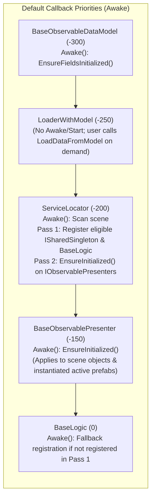
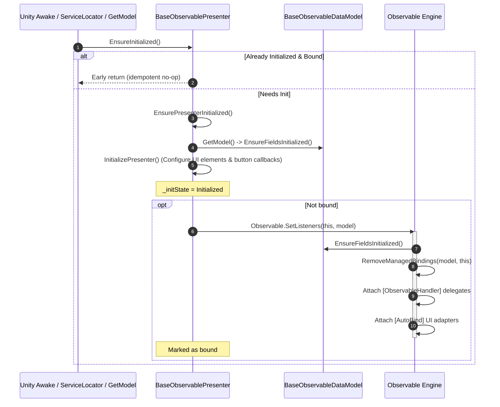
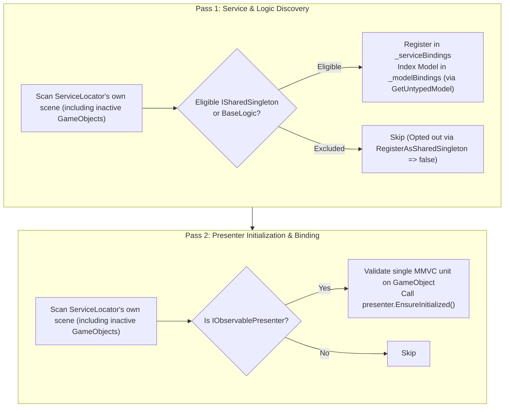
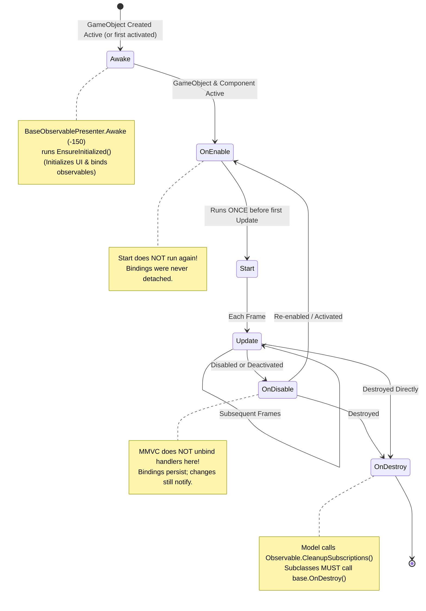
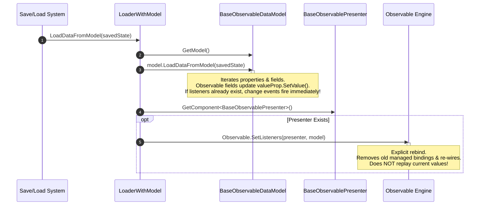

# Unity Lifecycle & Automatic SetListeners in MMVC

This document details the lifecycle hooks, script execution order defaults, discovery passes, and reactive binding mechanics of the MMVC framework for Unity.

---

## Quick Answer: Do I Need to Call `SetListeners` Manually?

**No.** For ordinary usage, you do not need to call `Observable.SetListeners(...)` manually.

- **Scene Objects:** `ServiceLocator` scans the scene on startup and automatically initializes all presenters and wires their `[AutoBind]` and `[ObservableHandler]` listeners.
- **Prefabs & Spawned Units:** When a prefab or unit is activated or when `logic.GetModel()` is called, `BaseObservablePresenter.Awake()` or `BaseLogic.GetModel()` automatically runs `EnsureInitialized()`, which wires all listeners idempotently.
- **When is manual calling used?** Only in specialized framework code (such as `LoaderWithModel.LoadDataFromModel` after overwriting model data) or custom low-level test harnesses.

---

## 1. Script Execution Order Defaults

MMVC assigns default execution orders to its core base classes via `[DefaultExecutionOrder]` attributes, which `MMVCExecutionOrderSynchronizer` (`Editor/MMVCExecutionOrderSynchronizer.cs`) applies across runtime scripts under `Assets/`:

| Order | Class | Primary Role | Lifecycle & Operational Details |
|---|---|---|---|
| **`-300`** | `BaseObservableDataModel` | Data Layer | `Awake()` calls `EnsureFieldsInitialized()`. Null `ObservableVariable<T>` and `ObservableList<T>` fields are instantiated and parent references set. |
| **`-250`** | `LoaderWithModel<M>` | Persistence Bridge | **Has NO `Awake()` or `Start()` of its own.** Defines save/load helper methods (`GetModelToSave()`, `LoadDataFromModel(state)`). Does not load or run automatically. |
| **`-200`** | `ServiceLocator` | Scene Discovery | `Awake()` scans **its own scene**. **Pass 1:** Registers eligible `ISharedSingleton` services and models. **Pass 2:** Calls `EnsureInitialized()` on all scene `IObservablePresenter` components (active and inactive). |
| **`-150`** | `BaseObservablePresenter<M>` | Presentation Layer | `Awake()` calls `EnsureInitialized()`. Runs `EnsurePresenterInitialized()`, executes `InitializePresenter()`, and binds `Observable.SetListeners()`. Subclasses overriding `Awake()` or `OnDestroy()` **must** call base methods, or prefer `InitializePresenter()`. |
| **`0`** | `BaseLogic<M, P>` | Business Logic | **Has NO `Start()` in the base class.** `Awake()` registers as an `ISharedSingleton` if not already discovered by `ServiceLocator`. Subclasses overriding `Awake()` or `OnDestroy()` **must** call base methods. Subclasses can implement `Start()`, `Update()`, etc. |

> **Important Architecture Note:**  
> These default orders provide priority ordering for Unity callbacks (e.g. `Awake`) between types, **not** a universal single-timeline guarantee across all arbitrary objects in a project, nor across dynamically instantiated runtime instances.



---

## 2. Presenter Initialization & SetListeners Sequence

Every `BaseObservablePresenter<M>` tracks its initialization state (`Uninitialized`, `Initializing`, `Initialized`) and whether its listeners are currently bound.

### Core Hook Mechanics
1. **`EnsurePresenterInitialized()`**:
   - Guards against reentrancy: if the presenter is already initialized or initializing, returns immediately.
   - Marks the presenter as initializing.
   - Calls `GetModel()` to ensure model and fields are ready.
   - Calls `protected virtual void InitializePresenter()`.
   - Marks the presenter as initialized. (Resets to uninitialized if an unhandled exception is thrown).
2. **`EnsureInitialized()`**:
   - Idempotency guard: if the presenter is initialized and bound, returns immediately (avoids duplicate binding).
   - Nested calls made while `InitializePresenter()` is running (for example through `logic.GetModel()`) return without binding. The outer call binds after `InitializePresenter()` completes.
   - Calls `EnsurePresenterInitialized()`.
   - If the presenter is not bound: invokes `Observable.SetListeners(this, model)`.
   - `Observable.RemoveListeners(model, presenter)` marks the presenter as unbound, so the next `EnsureInitialized()` rebinds. Explicit `Observable.SetListeners(presenter, model)` calls mark it as bound.
3. **`InitializePresenter()`**:
   - Subclass hook for configuring UI controls (wiring button clicks, setting dropdown choices, configuring canvas groups). Prefer this hook over overriding `Awake()`.
   - **Ordering guarantees:**
     - `InitializePresenter()` always completes **before** `Observable.SetListeners()` attaches handlers, including when it calls `GetLogic().GetModel()`.
     - For scene-resident objects initialized during `ServiceLocator` Pass 2, `InitializePresenter()` runs **after** Pass 1 service registration. Note, however, that service availability inside `InitializePresenter()` depends strictly on those services being present in the scanned scene, eligible, and unique (not collided or evicted).



---

## 3. ServiceLocator Scene Discovery: Scope & Guarantees

`ServiceLocator` executes at `-200`. In `Awake()`, `InitializeSharedSingletons()` discovers `MonoBehaviour` components:



### Discovery Scope & Boundaries
- **Scoped to Own Scene:** `ServiceLocator` scans `gameObject.scene.GetRootGameObjects()` (or falls back to `FindObjectsByType` if the scene is not loaded). Cross-scene services are not automatically merged.
- **Eligible Unique Services Only:**
  - Logic instances that override `RegisterAsSharedSingleton => false` are skipped in Pass 1.
  - If multiple live instances share the same class and have identical `singletonName` values, they collide and are evicted from lookup. `Services.Get<T>()` returns `null` and logs an error upon resolution.
  - Therefore, even for scene objects, service availability during Pass 2 depends on services being present, eligible, and non-collided.
- **Dynamic Prefabs / Early Explicit Init:** Prefabs instantiated dynamically at runtime, or components initialized before `ServiceLocator.Awake()`, are not covered by Pass 1 before their own code runs. Service availability cannot be guaranteed globally for dynamically spawned prefabs.

---

## 4. GetModel() Asymmetry: BaseLogic vs BasePresenter

There is a fundamental functional difference between calling `GetModel()` on `BaseLogic` versus `BasePresenter`:

| Component | Method | Behavior & Guarantee |
|---|---|---|
| **`BaseLogic<M, P>`** | `GetModel()` | Resolves `_model`, calls `_model.EnsureFieldsInitialized()`. If `!_presenterInitialized`, finds `P` on the same GameObject, sets `_presenterInitialized = true`, and calls `presenter.EnsureInitialized()`.<br>**Key Guarantee:** Explicitly initializes and binds the paired presenter, even if the GameObject is inactive. |
| **`BasePresenter<M>`** | `GetModel()` | Resolves `_model`, calls `_model.EnsureFieldsInitialized()`, and returns `_model`.<br>**Key Limitation:** Initializes model fields only. Does **not** initialize or bind the presenter. |

---

## 5. Unity Lifecycle & State Flow

The following state diagram illustrates the Unity lifecycle flow for MMVC components, demonstrating that reactive bindings established in `Awake`/`EnsureInitialized` persist across disable/enable cycles and remain active until object destruction.



### Component Lifecycle Realities:
1. **No Universal Cross-Method Ordering:** Setting execution order does **not** cause all `Awake()` calls across the entire universe to complete before any `OnEnable()` runs. For an active GameObject instantiated at runtime, Unity executes that object's `Awake()` followed immediately by `OnEnable()` before moving on.
2. **`Awake()` Execution:** Runs once when the component is created on an active GameObject (or when an inactive GameObject is first activated). Runs even if the component is disabled (`enabled = false`) as long as its GameObject is active.
3. **`OnEnable()` & `Start()` Execution:**
   - `OnEnable()` runs whenever the component and GameObject are both active.
   - `Start()` runs exactly **once** on enabled, active components before their first `Update()`. Re-enabling a component executes `OnEnable()`, but does **not** repeat `Start()`.
4. **`OnDestroy()` Limitation on Inactive Objects:**  
   Unity invokes `OnDestroy()` reliably only on GameObjects that have been active at least once. If a GameObject is created inactive, manually early-bound in code, and destroyed without ever being activated, Unity may not invoke `OnDestroy()`, causing `BaseObservableDataModel.OnDestroy()` to be skipped.  
   **Safety Rule:** For manually early-bound units that are destroyed while never activated, call `Observable.CleanupSubscriptions(model)` explicitly before destroying the GameObject.
5. **Subclass Overrides:**  
   Subclasses overriding `Awake()` or `OnDestroy()` **must call base methods** (`base.Awake()`, `base.OnDestroy()`). For presenters, overriding `InitializePresenter()` is strongly preferred over overriding `Awake()`.

---

## 6. Persistence Bridge: LoaderWithModel Sequence

`LoaderWithModel<M>` does not load automatically during startup. A save/load manager or custom script calls `LoadDataFromModel(state)` when loading game data:



> **Notification Behavior During Load:**  
> Source comments in `LoaderWithModel` state: *"Set up listeners AFTER model state is loaded to prevent notifications during load."*  
> However, if the presenter was already initialized (e.g. during scene startup), listeners are **already active** when `model.LoadDataFromModel(state)` copies field values. Setting properties via reflection on `ObservableVariable<T>.Value` will trigger change events during the copy. The subsequent call to `Observable.SetListeners(presenter, model)` then performs an explicit rebind.

---

## 7. Manual Foreign Subscriptions & Lifecycle Cleanup

When subscribing to an external or foreign model (e.g. `ScoreDataModel` on another GameObject):
```csharp
foreignModel.score.OnValueChanged.Add(OnScoreChanged, this);
```

### Cleanup Mechanics
1. **Source Model Lifetime vs Subscriber Lifetime:**  
   `Observable.CleanupSubscriptions(model)` executes when the **model** is destroyed (`BaseObservableDataModel.OnDestroy()`). If the subscriber component is destroyed while the foreign model remains alive, the model still holds the delegate reference.
2. **Dead Subscriber Dead-Filtering:**  
   `ObservableTrackedAction<T>.Invoke()` performs dead-target checks during invocation:
   ```csharp
   if (handler.Target is UnityEngine.Object unityTarget && unityTarget == null) {
       Remove(handler);
       continue;
   }
   ```
   Dead subscribers are automatically purged when the event next fires. However, they are not immediately cleaned up at the moment of subscriber destruction unless you manually call:
   ```csharp
   foreignModel.score.OnValueChanged.Remove(OnScoreChanged);
   ```

---

## 8. Limitations & Pitfalls

### Limitation: Current Behavior of SetListeners Has No Initial Value Replay
- **Current Behavior:** `Observable.SetListeners(subscriber, model)` connects delegates to `OnValueChanged` and registers UI adapters. It does not invoke callbacks with current values upon binding.
- **Remedy:** In `InitializePresenter()`, read current model values and set the UI controls directly:
  ```csharp
  protected override void InitializePresenter() {
      base.InitializePresenter();
      var model = GetModel();
      if (scoreText != null && model.score != null) {
          scoreText.text = model.score.Value.ToString();
      }
  }
  ```
  *(Do not attempt to re-assign model values like `model.score.Value = model.score.Value` in `InitializePresenter()`; assigning the same value does not invoke notifications if value equality is checked, and handlers are not even attached until after `InitializePresenter()` finishes!)*

### Pitfall: Operations on Inactive GameObjects
- Subscriptions persist while a component or GameObject is inactive. Modifying a model will trigger presenter callbacks even if its GameObject is inactive (provided the value actually changed).
- Calling `StartCoroutine(...)` on a `MonoBehaviour` whose GameObject is inactive will log an error in Unity. Ensure handlers guard against actions invalid on inactive objects.

---

## 9. Cross-References

- [Runtime Objects, Prefabs & Pooling](RuntimeObjects.md): Best practices for instantiating inactive prefabs, object pooling, and programmatic setup.
- [Testing Guide & Universal Test Runner](Testing.md): Running automated verification suites and contract assertions.
- Implementation Sources:
  - [`Runtime/BaseObservablePresenter.cs`](../Runtime/BaseObservablePresenter.cs)
  - [`Runtime/BasePresenter.cs`](../Runtime/BasePresenter.cs)
  - [`Runtime/BaseLogic.cs`](../Runtime/BaseLogic.cs)
  - [`Runtime/BaseObservableDataModel.cs`](../Runtime/BaseObservableDataModel.cs)
  - [`Runtime/LoaderWithModel.cs`](../Runtime/LoaderWithModel.cs)
  - [`Runtime/ServiceLocator.cs`](../Runtime/ServiceLocator.cs)
  - [`Runtime/Observable.cs`](../Runtime/Observable.cs)
  - [`Runtime/ObservableTrackedAction.cs`](../Runtime/ObservableTrackedAction.cs)
